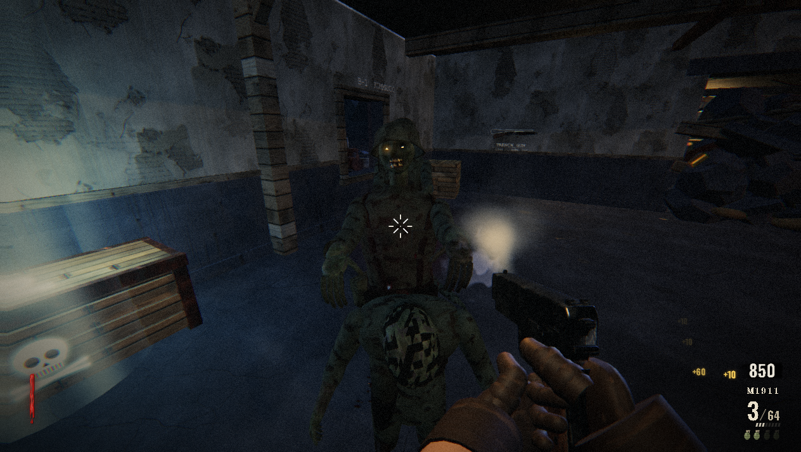

# UNBURIED — Blackwald Bunker — offline mirror

Full mirror of **UNBURIED — Blackwald Bunker** (https://unburied.inkwave.workers.dev/),
a round-based WWII zombie survival shooter built in three.js.

Source: https://unburied.inkwave.workers.dev/



## Stack

- **Hand-written ES module graph, no bundler** — the entry document carries an
  inline import map (`three` → `/vendor/three/build/three.module.js`,
  `three/addons/` → `/vendor/three/examples/jsm/`) and loads `/src/main.js`,
  which pulls the other twelve app modules through static and dynamic imports
- **three.js r185 in `vendor/`** — the served build (three.core.js + three.module.js)
  and the fourteen `examples/jsm` addons the app imports (postprocessing chain,
  shaders, `RoundedBoxGeometry`, `BufferGeometryUtils`), all byte-exact
- **PeerJS 1.5.5 UMD bundle vendored** — `vendor/peerjs/peerjs.min.js`, lazily
  injected on first co-op use (announced in `src/net.js` header)
- **Everything else is procedural** — textures are painted to canvases, audio is
  synthesized with WebAudio, the bunker level is built from code: the capture
  carries no image, model, audio or font payloads
- **Cloudflare Workers static host** — root-served; the origin answers
  `/index.html` with a 307 to `/`

## What this is

UNBURIED — Blackwald Bunker (unburied.inkwave.workers.dev) — "A round-based WWII
zombie survival shooter built in three.js": you hold a Blackwald bunker against
rounds of the undead (wall buys, doors, power, perks, a mystery box and an anvil;
solo or co-op over WebRTC with one host). The site is not a build artifact: the
served code is the authored source (named modules, comments, JSDoc), so the
mirror preserves both the running game and a readable record of it.

The capture is the whole runtime closure: 31 files, 3,598,685 bytes (3.6 MB) —
the entry document, the thirteen `/src/` app modules, the three.js r185 build
with its fourteen jsm addons, and the vendored PeerJS bundle. Closure was
iterated to fixpoint (static import/specifier/asset scan over every captured
file, with the entry import map resolving bare specifiers) and cross-checked
against the live browser's network log while actually playing: every request the
game makes is one of the 31 captured files, with zero 404s and zero off-origin
requests.

External: for solo play there is none at runtime — the page loads nothing
off-origin. Co-op signaling talks to the public PeerJS broker at
`0.peerjs.com` (multiplayer only; the vendored client is captured, the broker
itself cannot be mirrored — the game announces it in `src/net.js`).

## Layout

- `index.html` — the entry document as served (byte-exact); inline `<style>` +
  inline importmap, then `<script type="module" src="/src/main.js">`
- `src/` — the app modules as served (byte-exact capture): `main.js` (integrator:
  boot, renderer, input, menus/lobby, frame loop), `game.js` (rules + co-op
  session), `player.js`, `level.js`, `zombies.js`, `weapons.js`, `textures.js`,
  `audio.js`, `fx.js`, `post.js`, `hud.js`, `net.js`, `avatars.js` — **plus** the
  103 derived statement-aligned slices `src/<tag>-NN.js` (layout divergence: the
  origin serves the app under `/src/`, so capture and derived slices share the
  directory; derived names are `src__<module>-NN.js` and are never listed in the
  manifest)
- `vendor/` — what the import map resolves to: `three/build/three.core.js`,
  `three/build/three.module.js`, 14 `three/examples/jsm/**` addons,
  `peerjs/peerjs.min.js` (all byte-exact)
- `readable/` — prettified derived layer (pinned prettier 3.9.6, module API):
  30 `*.pretty.js` twins + `index-inline-1.pretty.{css,json}` for the entry's
  inline blocks + `index-inline-map.json` (byte ranges + sha256)
- `.upstream/manifest.json` — Gen-A sha256 record for all 31 captured files
- `split-spec.json` — the derivation record (122 sections, sources, inline map)
- `tools/derive.mjs` — rebuild `readable/` + `src/` + `split-spec.json`
- `tools/verify.mjs` — re-hash the capture against the manifest
- `tools/update.mjs` — read-only drift probe against the live origin
- `tools/audit.js` — integrity gate for the derived layers (`AUDIT PASS`)
- `docs/cover.png`, `docs/boot-2026-10-12.png` — cover + boot evidence (both
  captured in actual gameplay: solo round, zombies in frame, weapon + HUD)

## Assets

none — code/docs only. The capture carries no image, model, audio or font
payloads: the game paints its textures to canvases, synthesizes its audio with
WebAudio and builds the bunker from code; the only library assets are the
vendored JS trees above (`vendor/`). The favicon is an inline `data:` SVG.

## Run

Serve the repo root with any static file server (the capture is a static site;
no build step):

```
npx serve .
```

The game boots at `http://localhost:3000/` (add `?autoplay` to drop straight
into a solo round; `?net=local` forces the local transport).

## Verify

```
node tools/verify.mjs     # re-hash the capture against the manifest
node tools/audit.js       # derived-layer integrity gate
```

Last run: `31 files checked, 0 problems` and `AUDIT PASS`.

## Updating from upstream

```
node tools/update.mjs     # read-only drift probe: what changed upstream
```

The probe never rewrites the capture — a mirror is a point-in-time snapshot.
Refreshing means re-fetching the full runtime closure into a clean tree, copying
every replaced file into `legacy/<date>/`, re-cutting
`.upstream/manifest.json`, and re-deriving `readable/` + `src/` from the new
bytes with `node tools/derive.mjs`. Known noise: `_mirror-report.json` is a
local capture record and is never probed (excluded by name in `tools/update.mjs`).

### 2026-10-12 readable/src derivation

Both queued derived layers are in place, cut from the recorded capture (capture
bytes untouched — `node tools/verify.mjs` re-hashes all 31 files):

- `readable/` — pinned prettier 3.9.6 (module API, default options, single pass
  verified idempotent — never the CLI, it respects `.gitignore` and can silently
  echo its input) rendered all 30 captured JS files to `*.pretty.js` (30 files,
  132,054 pretty lines including the two inline twins; every pretty provably not
  a byte copy of its capture source, and 32/32 re-render byte-exact under the
  pinned version). Names are capture-relative with `/` flattened to `__`
  (`src__main`, `vendor__three__build__three.core`, …).
- Inline entry blocks: `index.html` carries an inline `<style>` and an inline
  importmap — both prettified to `readable/index-inline-1.pretty.{css,json}` and
  recorded with byte ranges + sha256 in `readable/index-inline-map.json`
  (the only inline `<script>` reference is the external `/src/main.js`).
- `src/` — 103 statement-aligned slices (`src__<module>-NN.js`, exact 2-line
  provenance header) across the 13 app modules, recorded in `split-spec.json`
  (122 sections): 103/103 parse standalone (`node --input-type=module --check -`)
  and round-trip byte-exact to their readable line ranges. Cuts land only on
  top-level declaration boundaries (~250–350 line windows); oversized single
  declarations stay whole (e.g. `src__game` yields 2 slices because its main
  declaration spans lines 60–2240). Identifiers are the app's own declared names —
  the served code is not minified, so no rename campaign (PLAN §5) applies.
- Vendor rule — wholeFile sections, never sliced (17): the three.js r185 build
  (guarded on `const REVISION = "185"` / `class WebGLRenderer`), the 14 jsm
  addons, and the minified PeerJS UMD bundle (guarded on `__peerData`).
  Non-standalone parts would be indexed as skipped sections; this capture has
  none (no trailing pure export tables), and there are no non-code payloads
  (`notRendered: 0`).
- Layout divergence (recorded): the origin serves the app under `/src/` and the
  libraries under `/vendor/`, so the byte-exact capture lives at `src/*.js` +
  `vendor/**` at the repo root (`DISK_PREFIX=""`) and the derived slices share
  `src/` with the captured modules. `tools/audit.js` asserts the split exactly:
  `src/` on disk == 13 captured modules (manifest-listed, byte-exact) ∪ 103
  ranged slices (`src__<module>-NN.js`, never in the manifest).
- Gates: `node tools/verify.mjs` → `31 files checked, 0 problems`;
  `node tools/audit.js` → `AUDIT PASS` (103/103 round-trips, 32/32 pretties
  re-render byte-exact, 32/32 tiled sources, 2 inline blocks with twins + map,
  23/23 imports resolve inside the capture — 0 whitelisted machinery, 2
  import-map entries); serve probe —
  mirror root served on loopback (`/`, `/src/main.js`, the three.js build, the
  PeerJS bundle over HTTP 200; bytes identical to capture), the listener killed,
  port 4310 closed (netstat + connection refused). Boot evidence and cover are
  real gameplay (`docs/boot-2026-10-12.png`, `docs/cover.png`) — solo round in
  the bunker with zombies in frame, M1911 and HUD, captured through the opencli
  browser against the served mirror; the network log matched the 31-file capture
  exactly. Rebuild with `node tools/derive.mjs`.
- §0.4 fork-over-mirror checked 2026-10-12: neither the page nor any captured JS
  references a public source repo (zero `github.com`/`gitlab.com` references in
  the whole capture), and a GitHub repository search for "UNBURIED Blackwald
  Bunker" finds nothing — the origin publishes the deployment only, so the
  mirror stands.

## Mirror conventions

- **Capture layer** — the captured files are byte-exact copies of what the
  origin served; nothing in them is edited. Vendor files (three.js, PeerJS) stay
  byte-exact exactly as served — never re-minified or re-hosted.
- **Readable layer** — `readable/` is derived (prettified) and never shipped to
  a browser; it exists so the served code can be read in one place.
- **Provenance** — `.upstream/manifest.json` records sha256 for each captured
  artifact, and `tools/verify.mjs` re-checks it.
- **Drift** — `tools/update.mjs` is read-only: it reports what changed upstream
  and never rewrites the capture.
- **Layout divergence** — the capture lives at the repo root (`index.html`,
  `src/`, `vendor/`) because the origin serves it there; the derived slices share
  `src/` with the captured modules and are distinguished by their
  `src__<module>-NN.js` names (never manifest-listed).

## Fleet status

<!-- mirror-status:start — feeds _standard/REPO-INDEX.md. Update ONLY your own mirror's block; never edit the shared index (PLAN §8). Rebuild: node _standard/build-index.mjs -->
<!-- cols: cls=classification · ver=verify 0 problems · upd=drift probe · man=manifest · rdbl=readable re-derived · src=reversed src · boot=boot test · top=offline-mirror topic · tag=backup tag · staged=staged not committed -->
| # | repo | cls | ver | upd | man | rdbl | src | boot | top | tag | staged |
|---|---|---|---|---|---|---|---|---|---|---|---|
| 295 | unburied | mirror | ✓ | ✓ | ✓ | ✓ | ✓ | ✓ | ✓ | — | — |
<!-- mirror-status:end -->
